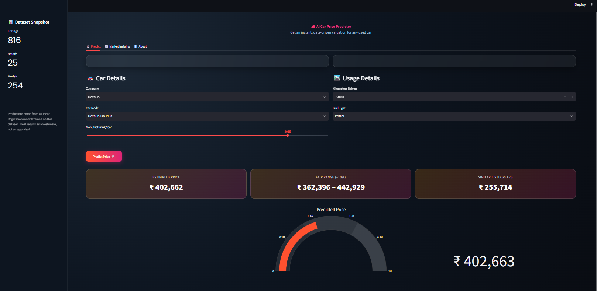

# Car Price Prediction Using Machine Learning

A Machine Learning project that predicts the estimated selling price of used cars using Linear Regression. This project combines data preprocessing, feature engineering, model training and evaluation with an interactive Streamlit web application.

## Project Overview

This project aims to estimate the price of a used car based on its specifications and usage details.

Using the `quikr_car.csv` dataset, a Linear Regression model is developed to predict car prices based on five features: car model, manufacturing company, manufacturing year, kilometers driven and fuel type.

The trained Machine Learning pipeline is integrated into a Streamlit application that provides interactive price predictions and visual insights into used-car listings.

## Application Preview



## Key Features

- **Car Price Prediction:** Estimates the selling price of used cars based on their specifications.
- **Interactive Web Application:** User-friendly interface developed using Streamlit.
- **Dataset Snapshot:** Displays the total number of listings, brands and car models.
- **Market Insights:** Visualizes average car prices by company.
- **Fuel Type Distribution:** Displays the distribution of listings across different fuel types.
- **Year-wise Analysis:** Shows car listing trends across manufacturing years.
- **Price Comparison:** Displays estimated price ranges and average prices of similar listings.
- **Interactive Visualizations:** Uses Plotly for graphical representation of market insights.

## Machine Learning Workflow

1. **Data Loading:** Imported the original dataset (`quikr_car.csv`) using Pandas.
2. **Data Inspection:** Examined dataset structure, missing values, data types and unique values.
3. **Data Preprocessing:** Cleaned inconsistent manufacturing years, prices, kilometer values and missing fuel types.
4. **Feature Preparation:** Separated independent variables and the target variable.
5. **Categorical Encoding:** Applied One-Hot Encoding to categorical features.
6. **Model Building:** Developed a Linear Regression model using a Scikit-learn pipeline.
7. **Initial Evaluation:** Evaluated the model using an 80:20 train-test split.
8. **Random-State Experimentation:** Tested 1,000 different random states using a 90:10 train-test split to identify the best-performing split.
9. **Final Model Training:** Trained the final Linear Regression pipeline using the selected random state.
10. **Model Evaluation:** Evaluated the final model using the R² score.
11. **Model Saving:** Exported the trained pipeline using Pickle.
12. **Application Development:** Integrated the trained model into a Streamlit web application.

## Model Information

| Component | Description |
|---|---|
| Algorithm | Linear Regression |
| Framework | Scikit-learn |
| Categorical Encoding | One-Hot Encoding |
| Model Architecture | Machine Learning Pipeline |
| Initial Train-Test Split | 80:20 |
| Final Train-Test Split | 90:10 |
| Random-State Experiments | 1,000 |
| Evaluation Metric | R² Score |
| Model Serialization | Pickle |

### Features Used

- `name` – Car model
- `company` – Manufacturing company
- `year` – Manufacturing year
- `kms_driven` – Kilometers driven
- `fuel_type` – Fuel type

**Target Variable:** `Price`

## Dataset Information

The project uses `quikr_car.csv` as the original dataset.

Data preprocessing includes:
- Handling inconsistent and invalid manufacturing years.
- Cleaning price values and converting them into numeric format.
- Extracting numeric values from kilometer-driven entries.
- Handling missing fuel types.
- Simplifying car names for consistent feature representation.
- Removing invalid records.

The preprocessed dataset is saved as `Cleaned_Car_data.csv` and used by the Streamlit application.

## Technologies Used

- **Programming Language:** Python
- **Machine Learning:** Scikit-learn
- **Data Manipulation:** Pandas, NumPy
- **Data Visualization:** Plotly
- **Web Application:** Streamlit
- **Development Environment:** Jupyter Notebook
- **Model Serialization:** Pickle
- **Version Control:** Git and GitHub


## Installation and Setup

### 1. Clone the Repository

```bash
git clone https://github.com/YOUR-USERNAME/Car-Price-Prediction-Using-Machine-Learning.git
```

### 2. Navigate to the Project Directory

```bash
cd Car-Price-Prediction-Using-Machine-Learning
```

### 3. Create a Virtual Environment (Optional)

```bash
python -m venv venv
```

Activate the environment:

**Windows:**
```bash
venv\Scripts\activate
```

**Mac/Linux:**
```bash
source venv/bin/activate
```

### 4. Install Dependencies

```bash
pip install -r requirements.txt
```

### 5. Run the Application

```bash
streamlit run app.py
```

The application will open in your default web browser.

## Application Sections

### 1. Predict
Enter the car company, model, manufacturing year, kilometers driven and fuel type to generate an estimated selling price.

The application displays:
- Estimated car price
- Fair price range (±10%)
- Average price of similar listings
- Interactive price gauge

### 2. Market Insights
Explore used-car market trends through interactive visualizations:
- Average price by company
- Fuel type distribution
- Year-wise listing distribution

### 3. About
Provides information about the Linear Regression algorithm and the input features used for price prediction.

## Generated Files

The Jupyter Notebook generates the following files during execution:

- `Cleaned_Car_data.csv` – The preprocessed dataset.
- `LinearRegressionModel.pkl` – The trained Machine Learning pipeline.

Both generated files are included in this repository so that the Streamlit application can run directly without executing the notebook again.

## Disclaimer

The predicted prices are estimates generated using a Linear Regression model trained on historical used-car listing data. They should be treated as indicative values rather than official market valuations or guaranteed selling prices.

## Author

**Simrat Kaur**

B.Tech – Computer Science and Engineering (Artificial Intelligence & Machine Learning)


